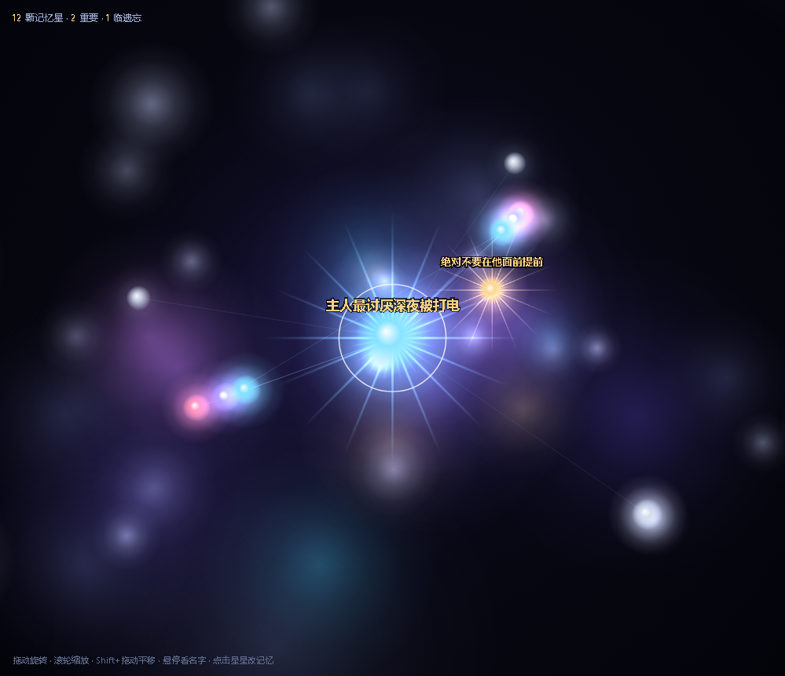

# 大肥鱼记忆星图 · Dayu Memory Star

> 把智能体的长期记忆变成一片可以走进去的星图。
> 内置**艾宾浩斯遗忘曲线 + 权重系统**的记忆模型，纯本地 JSON 存储、零依赖、零外部服务；同时提供给 QQBridge / AstrBot 直接调用的记忆核心。



一个 DeepSeek Harness 插件：装上就能在 Web 端右下角打开一片星空——每条记忆是一颗星，重要的会亮着星芒、浮着名字，互相关联的会被线连起来。点开任何一颗星都能改内容、改权重、删除、加细节。

## 它能做什么

| 功能 | 说明 |
| --- | --- |
| 🌌 3D 星图 | 记忆卡片 = 星星。中心大星是当前最重要那条（按 `important` → 权重 → 频率自动排）。星云 / 雾 / 射线 / 悬停看名字 / 拖动旋转 / Shift 平移 |
| 🕸 人物关系图 | 主人、大肥鱼自己、群友；可改名、加人、连线，并可分别编辑「主人与 TA 的关系」「大肥鱼与 TA 的关系」 |
| 📊 上下文用量 | 本次请求占用 / 历史累计两条横条，含每个会话明细 |
| 🧠 记忆模型 | 摘要卡片 + 细节外挂两级结构；MinHash + Jaccard 相似度去重（≥0.85 合并）；五类记忆（规则 / 偏好 / 目标 / 情感 / 日常）；艾宾浩斯遗忘曲线自动忘掉不重要的日常 |
| 🔌 可复用核心 | `lib/memory-core.js` 单文件零依赖：QQBridge（Node）直接 `require`，AstrBot（Python）走本机 HTTP 接口 |
| 🤖 智能体工具 | 注册 `dayu_memory_search` / `dayu_memory_remember`，让智能体自己记事情 |

## 安装

装完刷新页面，右下角出现「记忆星图」按钮。

**① 从链接装（推荐）**：DSH → 设置 → 插件 → 添加插件 → 粘贴
- 压缩包直链：`https://github.com/<你>/dsh-dayu-memory-star/releases/download/v1.0.0/dsh-dayu-memory-star-1.0.0.tgz`
- 或仓库地址：`https://github.com/<你>/dsh-dayu-memory-star.git`

**② 从本地目录装**：添加插件 → 填本仓库目录的绝对路径

**③ 命令行**

```bash
dsh plugin --profile desktop add "https://github.com/<你>/dsh-dayu-memory-star.git"
```

> 本包**没有任何构建脚本**（无 `postinstall` / `prepare` / 编译），所以 pnpm 的「是否允许运行构建脚本」提示不会出现；即使出现，直接拒绝也能正常用。

> 万一没出现「记忆星图」按钮（宿主版本较老、注入不进首屏），直接在地址栏打开
> `http://127.0.0.1:54800/dayu-memory-star`（端口换成你 DSH 实际用的）也能进星图。

## 记忆存在哪

插件按顺序找**第一个已有 `cards.json` / `facts.json`** 的目录，所以已有的记忆库会被自动认出来、不用搬：

```
配置 dataDir → DAYU_MEMORY_DIR → ~/.dsh/dayu-memory → ~/.dayu-memory/memory
→ ~/.dayu-memory → ./memory → ./data/memory → ./dayu-memory
→ %TEMP%/ds-shichuan/memory → %TEMP%/ds-shichuan → 默认 ~/.dsh/dayu-memory（新建）
```

打开「状态」标签页能看到实际用的路径；不对就设环境变量 `DAYU_MEMORY_DIR` 指过去。

## 新手什么都不用配

装上就能用，不用先「做一个记忆模型」：

| 你的情况 | 插件会自动做什么 |
| --- | --- |
| 机器上一条记忆都没有 | 用 `~/.dsh/dayu-memory`，不立刻建文件；星图打开是空星空 + 「记忆库还是空的」，写第一条时自动建 `cards.json` |
| 已经有 `%TEMP%\ds-shichuan\memory` 的「大肥鱼」老部署 | 自动认出那套记忆库，不用搬文件、不用改配置 |
| 记忆库在别处 | 设 `DAYU_MEMORY_DIR` 指过去 |
| 库里有多个人（群聊池） | 配 `ownerId` 只看这个主人的 |
| 你的智能体不叫「大肥鱼」 | 配 `soul` 换成自己的常驻设定（默认三条完全没有「大肥鱼」人格） |
| 老记忆库字段不全 | 缺 `type` 兜底成「日常」，缺时间按创建时间算保留率，不报错 |

这些都有自动化测试盯着：`test/cold-start.js`（51 项，含真实浏览器打开空库页面）。

## 分类与能力声明

**分类**：工具类 → 记忆与知识管理（Memory & Knowledge）→ 附带数据可视化（Visualization）。
它不产生回复，只负责记住 / 忘掉 / 取回。

| 能力 | 用没用 | 说明 |
| --- | --- | --- |
| 文件与环境 | ✅ | 只读写自己数据目录下的 `cards.json` / `facts.json` / `relations*.json` / `context_usage.json` / `*_profile.json`；不扫描其它目录、不上传任何文件 |
| 网络 | ❌ | 零出站请求（无遥测、无授权校验、无 API Key）。只注册本机同源路由 `/dayu-memory-star/*` 给自己的前端取数 |
| 执行 | ⚠️ 有限 | 不起子进程、不跑 shell、不加载原生二进制；只注册两个智能体工具，读写范围同上 |
| 构建脚本 | ❌ 无 | 无 `postinstall` / `prepare` / 编译；`approvedBuilds` 可为空 |

## 文档

- 📘 [中文完整文档（运行原理 / 整体模型 / 全部功能 / 接入示例 / FAQ）](./README.zh.md)
- 📗 [English documentation](./README.en.md)
- 🧪 自检：`node test/smoke.js`（142 项）
- 📄 [MIT](./LICENSE)

## 目录

```
dsh-dayu-memory-star/
├─ package.json          dsh.manifestVersion=1 / bundle.patch / icon
├─ cordis.patch.yml      bundle 插入声明
├─ lib/index.js          Host 半侧：HTTP 路由 + 首屏注入 + 两个智能体工具
├─ lib/memory-core.js    记忆核心（零依赖，可独立复用）
├─ lib/client.js         浏览器半侧：Canvas 2D 星图 + 关系图 + 四标签侧栏
├─ examples/             QQBridge(JS) / AstrBot(Python) 现成接入示例
├─ locale/{zh,en}.json   插件标题与描述
└─ test/smoke.js         142 项自检
```

MIT · 随便 fork，随便改成你自己的记忆星图。

---

<sub>English version of this page: [README.en.md](./README.en.md)</sub>
